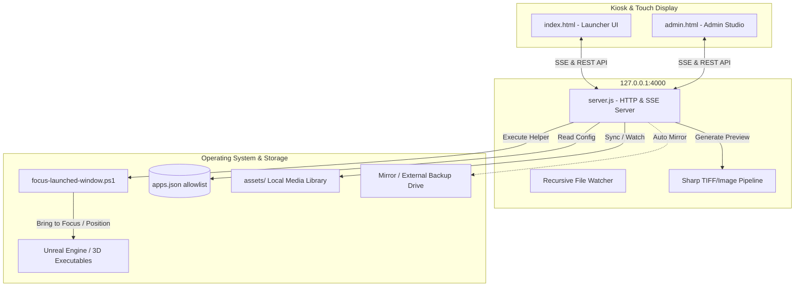

# 🏛️ VastuChitra (वास्तुचित्र)

> **High-Performance Touch-Screen Launcher & Interactive Experience Center Studio**  
> *Architectural Visualization • Unreal Engine Builds • 3D Walkthroughs • High-Res Media Showcases • Touch Kiosks*

[](https://nodejs.org/)
[](https://microsoft.com)
[](https://sharp.pixelplumbing.com/)
[](https://github.com/UmeAfk/VastuChitra)

---

## 🌟 Overview

**VastuChitra** is a specialized, production-ready interactive presentation launcher and live administration studio built for architectural visualization firms, real estate experience centers, museums, and interactive exhibitions.

Designed to run on large touch displays, touch tables, or multi-display kiosk environments, VastuChitra bridges the gap between web experiences, gigapixel media assets, and heavy real-time 3D desktop applications (such as **Unreal Engine**, **Twinmotion**, and **Unity**).

Equipped with a live **Admin Studio**, presenters and exhibition curators can dynamically organize project cards, stream multi-gigabyte media without browser-memory limitations, preview high-resolution TIFF architectural renders on the fly, and launch allowlisted applications directly onto designated monitors.

---

## ✨ Key Features

### 🖥️ Kiosk & Display Engine
* **True Full-Screen Kiosk Integration:** Built-in automation scripts launch Chrome or Microsoft Edge with isolated user profiles, zero browser navigation chrome, disabled pinch-zoom gestures, and disabled overscroll navigation.
* **Dual & Multi-Monitor Support:** Target primary or secondary displays with customizable resolution and window positioning (`--window-position=X,Y`).
* **Logo-Hold Security Lock:** Kiosk mode hides administrative controls behind a configurable logo long-press gesture, protected by an administrative Veil passcode.
* **Interactive Idle Timer:** Automatic reset to home screen / slideshow presentation when idle during public exhibition hours.

### 🚀 Native App Launcher & Window Controller
* **Allowlisted Program Execution:** Applications are declared in `apps.json`. The web interface communicates only via unique IDs, preventing arbitrary executable path injection.
* **Win32 Window Focusing (`focus-launched-window.ps1`):** Automatically detects newly spawned windows, maximizes or positions them on the designated monitor, and brings them to the foreground ahead of the kiosk window.
* **Support for Native 3D Engines:** Flawlessly launch and terminate packaged Unreal Engine Win64 Shipping builds, Twinmotion presentations, VR tours, or external web tours.

### 🖼️ Architectural Media Pipeline
* **Native TIF / TIFF Render Support:** Leverages high-performance [Sharp](https://sharp.pixelplumbing.com/) (libvips) to generate lossless cached PNG previews and thumbnails from massive uncompressed architectural TIFF renders with ICC profile preservation.
* **HTTP Byte-Range Video Streaming:** Smooth scrubbing and instant playback for large 4K/HD video files (`.mp4`, `.webm`, `.mov`, `.m4v`, `.mkv`, `.avi`, `.ogv`).
* **Direct-to-Disk Uploads:** Streams multi-gigabyte files directly to disk without browser base64 overhead or memory limits.
* **Recursive Folder Watcher:** File Explorer operations (copy, paste, rename, delete) reflect in the Admin Studio in real time via Server-Sent Events (SSE).
* **Automated Mirroring / Backups:** Optional secondary drive mirror path synchronizes media assets automatically upon modification.

### ⚙️ Live Admin Studio
* **Drag-and-Drop Card Layouts:** Reorder and configure project cards on an interactive visual grid.
* **Presentation Customizer:** Adjust grid columns, rows, card gaps, border radius, tilt sensitivity, artwork zoom, intro animation speed, and transition curves.
* **Instant Kiosk Sync:** Any changes made in Admin Studio push live updates over SSE to all connected kiosks without manual browser refreshes.

---

## 🏗️ System Architecture



---

## 📂 Project Structure

```text
vastuchitra/
├── index.html                 # Touch-optimized public launcher interface
├── admin.html                 # Admin Studio for layout, media, & settings
├── server.js                  # Local server, SSE broadcaster, API & process launcher
├── package.json               # Node.js dependencies and lifecycle scripts
├── apps.json                  # Allowlisted native applications and launch configurations
├── media-config.json          # Machine-specific media library path (git-ignored)
├── media-config.example.json  # Template configuration for media library paths
├── fix_admin.ps1              # Maintenance helper script for admin layout
├── focus-launched-window.ps1  # PowerShell Win32 automation for positioning native apps
├── start-web.bat              # Batch script: starts server and opens normal browser
├── start-kiosk.bat            # Batch script: starts server and opens fullscreen kiosk
├── assets/                    # Default local media library folder
│   └── .gitkeep               # Preserves directory in git while media is ignored
├── public/                    # Static branding artwork
│   └── logo-ui.png            # Optimized UI logo asset
├── css/
│   ├── styles.css             # Launcher presentation styles & animation system
│   └── admin.css              # Admin Studio styling & layout controls
└── js/
    ├── projects.js            # Stored project definitions, grid settings, and cards
    ├── script.js              # Launcher frontend logic, touch gestures, and SSE client
    └── admin.js               # Admin Studio frontend controller and media manager
```

---

## ⚡ Prerequisites

* **Operating System:** Windows 10 or Windows 11 (64-bit).
* **Node.js:** Version 18.0.0 or higher ([Download Node.js](https://nodejs.org/)).
* **Browser:** Google Chrome or Microsoft Edge (used by kiosk launch scripts).
* **Hardware:** Dedicated GPU recommended if launching real-time 3D Unreal Engine applications.

---

## 🚀 Quick Start

### 1. Clone & Install

```powershell
# Clone the repository
git clone https://github.com/UmeAfk/VastuChitra.git
cd VastuChitra

# Install production dependencies (including Sharp)
npm install
```

### 2. Verify Syntax

Ensure all scripts pass syntax and integrity checks:

```powershell
npm run check
```

### 3. Run the Application

#### Option A: Normal Web Mode (For Configuration & Testing)
Double-click `start-web.bat` or run:
```powershell
npm start
```
* **Launcher UI:** [http://localhost:4000](http://localhost:4000)
* **Admin Studio:** [http://localhost:4000/admin.html](http://localhost:4000/admin.html)

#### Option B: Full-Screen Kiosk Mode (For Exhibition & Production)
Double-click `start-kiosk.bat`.  
This boots the server and launches Chrome/Edge in standalone fullscreen kiosk mode with gestures optimized for touch screens.

---

## 🔧 Configuration Guide

### 1. Application Launcher (`apps.json`)

To enable native program execution from project cards, register applications in `apps.json`:

```json
{
  "meridian-residence": {
    "exe": "C:\\Projects\\Meridian\\Meridian.exe",
    "args": ["-windowed", "-WinX=1920", "-WinY=0"],
    "stopImage": "Meridian-Win64-Shipping.exe",
    "windowMode": "maximized",
    "resolution": "1920x1080",
    "resolutionWidth": 1920,
    "resolutionHeight": 1080,
    "displayTarget": "primary"
  },
  "web-panoramic-tour": {
    "url": "https://tours.example.com/project-01",
    "args": ["--kiosk", "--window-position=1920,0"]
  }
}
```

#### Launch Properties:
| Parameter | Description |
|---|---|
| `exe` | Absolute path to the native Windows executable. |
| `args` | Array of command-line arguments passed to the program. |
| `cwd` | Optional working directory. |
| `stopImage` | Process image name (e.g. `Project-Win64-Shipping.exe`) for cleanup and monitoring. |
| `windowMode` | `maximized` (default), `normal`, or `minimized`. |
| `resolution` | `native`, `1920x1080`, `3840x2160`, or `custom` with explicit width and height. |
| `displayTarget` | `primary` (default) or `secondary` monitor target. |

### 2. Media Storage Configuration (`media-config.json`)

By default, media files reside in `./assets`. You can redirect storage to high-speed NVMe drives or external storage arrays via Admin Studio or by creating `media-config.json`:

```json
{
  "rootPath": "D:\\VastuChitra\\HighResMedia",
  "mirrorPath": "E:\\Backups\\VastuChitraMedia",
  "collisionPolicy": "rename"
}
```
* **`rootPath`**: Authoritative storage path for images, videos, and PDFs.
* **`mirrorPath`**: (Optional) Destination folder automatically synced when media changes.
* **`collisionPolicy`**: Upload collision rule: `rename` (append `_1`, `_2`), `replace`, or `skip`.

---

## 🛡️ Security & Best Practices

1. **Localhost Binding:** `server.js` strictly binds to `127.0.0.1`. Do not expose port 4000 directly to public networks.
2. **Safe Process Launching:** The launcher frontend can only invoke keys pre-configured in `apps.json`. It cannot execute arbitrary scripts or paths requested by client queries.
3. **Admin Veil Access:** Admin Studio is gated with a front-facing passcode lock intended for floor curators and booth managers.
4. **Git Repository Hygiene:** Large multi-gigabyte media assets and environment-specific `media-config.json` are excluded via `.gitignore`. Store actual media on local presentation drives or shared NAS backups.

---

## 🛠️ Troubleshooting

| Issue | Cause | Solution |
|---|---|---|
| **Port 4000 already in use** | Another instance or process is using port 4000. | Set environment variable `$env:PORT=4005; npm start` or terminate the existing Node process. |
| **Kiosk does not enter true fullscreen** | Chrome / Edge is not found in standard paths. | Check `start-kiosk.bat` paths or add Chrome to Windows `PATH`. |
| **Launched app appears behind kiosk** | Win32 focus permission policy. | `focus-launched-window.ps1` handles this automatically; ensure PowerShell execution policy allows script execution (`RemoteSigned`). |
| **TIFF preview generation fails** | Memory limit on huge files. | Sharp handles unlimited pixel buffers, but ensure disk temp storage has sufficient free space in `%TEMP%`. |
| **External video does not play** | Unsupported video codec. | Re-encode videos to standard H.264 / MP4 or VP9 / WebM formats. |

---

## 📄 License

Internal & Commercial Distribution — **VastuChitra Experience Studio**.  
All rights reserved. Proprietary software for interactive architectural visualization displays.
