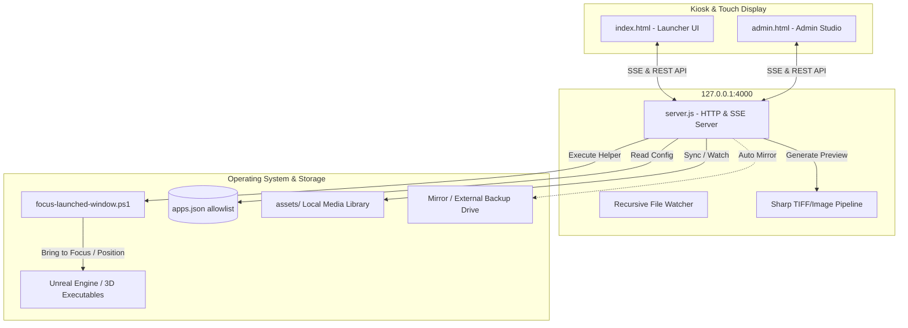

# 🏛️ VastuChitra

> **High-Performance Touch-Screen Launcher & Interactive Experience Center Studio**  
> *Architectural Visualization • Unreal Engine Builds • 3D Walkthroughs • High-Res Media Showcases • Touch Kiosks*

[](https://nodejs.org/)
[](https://microsoft.com)
[](https://sharp.pixelplumbing.com/)
[](https://github.com/UmeAfk/VastuChitra)

---

## 🌟 Overview

**VastuChitra** is a specialized, production-ready interactive presentation launcher and live administration studio built for architectural visualization firms, real estate experience centers, museums, and interactive exhibitions.

Designed to run on large touch displays, touch tables, or multi-display kiosk environments, VastuChitra bridges the gap between web experiences, gigapixel media assets, and heavy real-time 3D desktop applications (such as **Unreal Engine**, **Twinmotion**, and **Unity**).

Equipped with a live **Admin Studio**, presenters and exhibition curators can dynamically organize project cards, stream multi-gigabyte media without browser-memory limitations, preview high-resolution TIFF architectural renders on the fly, and launch allowlisted applications directly onto designated monitors.

---

## ✨ Key Features

### 🖥️ Kiosk & Display Engine
* **True Full-Screen Kiosk Integration:** Built-in automation scripts launch Chrome or Microsoft Edge with isolated user profiles, zero browser navigation chrome, disabled pinch-zoom gestures, and disabled overscroll navigation.
* **Dual & Multi-Monitor Support:** Target primary or secondary displays with customizable resolution and window positioning (`--window-position=X,Y`).
* **Logo-Hold Security Lock:** Kiosk mode hides administrative controls behind a configurable logo long-press gesture, protected by an administrative Veil passcode.
* **Interactive Idle Timer:** Automatic reset to home screen / slideshow presentation when idle during public exhibition hours.

### 🚀 Native App Launcher & Window Controller
* **Allowlisted Program Execution:** Applications are declared in `apps.json`. The web interface communicates only via unique IDs, preventing arbitrary executable path injection.
* **Win32 Window Focusing (`focus-launched-window.ps1`):** Automatically detects newly spawned windows, maximizes or positions them on the designated monitor, and brings them to the foreground ahead of the kiosk window.
* **Support for Native 3D Engines:** Flawlessly launch and terminate packaged Unreal Engine Win64 Shipping builds, Twinmotion presentations, VR tours, or external web tours.

### 🖼️ Architectural Media Pipeline
* **Native TIF / TIFF Render Support:** Leverages high-performance [Sharp](https://sharp.pixelplumbing.com/) (libvips) to generate lossless cached PNG previews and thumbnails from massive uncompressed architectural TIFF renders with ICC profile preservation.
* **HTTP Byte-Range Video Streaming:** Smooth scrubbing and instant playback for large 4K/HD video files (`.mp4`, `.webm`, `.mov`, `.m4v`, `.mkv`, `.avi`, `.ogv`).
* **Direct-to-Disk Uploads:** Streams multi-gigabyte files directly to disk without browser base64 overhead or memory limits.
* **Recursive Folder Watcher:** File Explorer operations (copy, paste, rename, delete) reflect in the Admin Studio in real time via Server-Sent Events (SSE).
* **Automated Mirroring / Backups:** Optional secondary drive mirror path synchronizes media assets automatically upon modification.

### ⚙️ Live Admin Studio
* **Drag-and-Drop Card Layouts:** Reorder and configure project cards on an interactive visual grid.
* **Presentation Customizer:** Adjust grid columns, rows, card gaps, border radius, tilt sensitivity, artwork zoom, intro animation speed, and transition curves.
* **Instant Kiosk Sync:** Any changes made in Admin Studio push live updates over SSE to all connected kiosks without manual browser refreshes.

---

## 🏗️ System Architecture



---

## 📂 Project Structure

```text
vastuchitra/
├── index.html                 # Touch-optimized public launcher interface
├── admin.html                 # Admin Studio for layout, media, & settings
├── server.js                  # Local server, SSE broadcaster, API & process launcher
├── package.json               # Node.js dependencies and lifecycle scripts
├── apps.json                  # Allowlisted native applications and launch configurations
├── media-config.json          # Machine-specific media library path (git-ignored)
├── media-config.example.json  # Template configuration for media library paths
├── fix_admin.ps1              # Maintenance helper script for admin layout
├── focus-launched-window.ps1  # PowerShell Win32 automation for positioning native apps
├── start-web.bat              # Batch script: starts server and opens normal browser
├── start-kiosk.bat            # Batch script: starts server and opens fullscreen kiosk
├── assets/                    # Default local media library folder
│   └── .gitkeep               # Preserves directory in git while media is ignored
├── public/                    # Static branding artwork
│   └── logo-ui.png            # Optimized UI logo asset
├── css/
│   ├── styles.css             # Launcher presentation styles & animation system
│   └── admin.css              # Admin Studio styling & layout controls
└── js/
    ├── projects.js            # Stored project definitions, grid settings, and cards
    ├── script.js              # Launcher frontend logic, touch gestures, and SSE client
    └── admin.js               # Admin Studio frontend controller and media manager
```

---

<p align="center">
  Built With 💙 Made By <a href="https://venusapp.in">Veil</a>
</p>